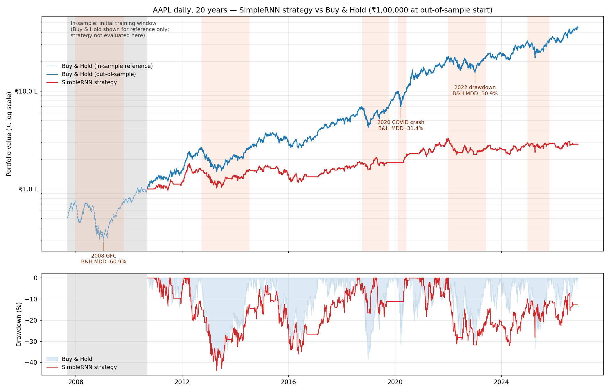
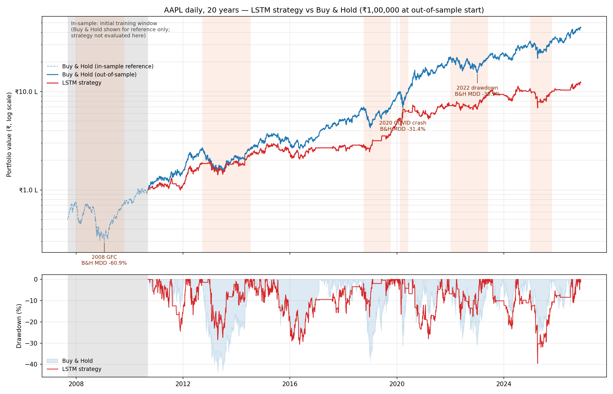
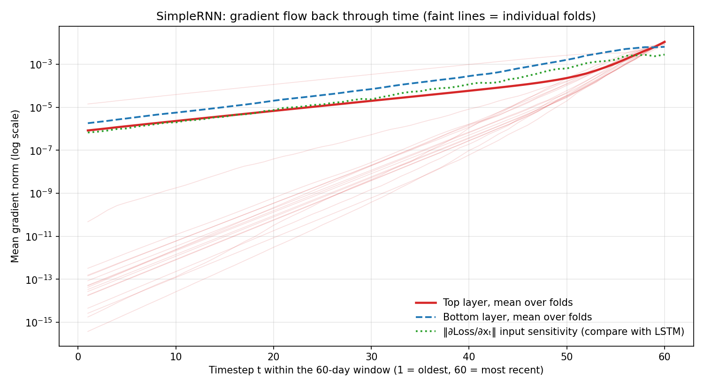
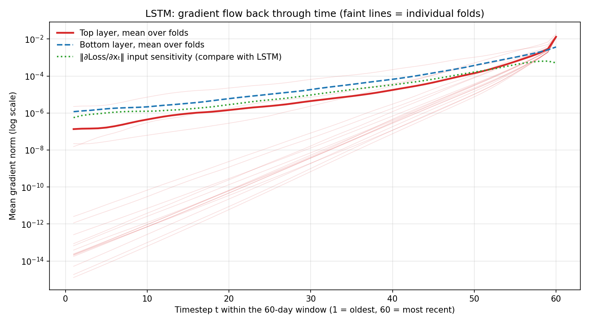

# Comparative Study on LSTM and RNN Performance on Sequential Stock Data

Simple RNN vs LSTM on 20 years of daily Apple (AAPL) prices.

**Author:** Sudha

A modular PyTorch A/B experiment. A **Simple RNN** and an **LSTM** use identical data,
features, hyperparameters, seeds and backtest rules, so the only difference is the
recurrent cell. The experiment tests whether the Simple RNN suffers from vanishing
gradients and fails to adapt to market crashes.

> For education and research only. This is not investment advice and places no real trades.

## Setup

| | |
|---|---|
| Asset | Apple Inc. (`AAPL`), daily bars from yfinance, 20 years, adjusted prices |
| Inputs (12) | OHLCV, SMA-50, SMA-200, MACD, MACD signal, 20-day return volatility, month sin/cos |
| Target | Next-day close (the model predicts the log change, which is then converted back to USD) |
| Model | 2 layers × 64 hidden, dropout 0.2, window 60, Adam (lr 1e-3), MSE, gradient clip 1.0, early stopping (patience 10), seed 42 |
| Validation | Expanding walk-forward: 3-year initial window, retrain every 252 trading days, 17 folds; scalers re-fitted per fold; a no-lookahead assertion checks every fold |
| Backtest | Long next day if the predicted close beats today's by more than the round-trip cost, otherwise cash; 0.05% cost per side; ₹1,00,000 starting capital (FX-neutral) |

## Results: out-of-sample, Sep 2010 → Nov 2026

| Metric | Simple RNN | LSTM | Buy & Hold |
|---|---|---|---|
| Total ROI | 187.4% | 1,145.5% | 4,395.4% |
| Net profit | ₹1,87,379 | ₹11,45,482 | ₹43,95,449 |
| Sharpe ratio | 0.43 | 0.82 | **0.98** |
| Max drawdown | −43.7% | **−39.6%** | −43.8% |
| Directional accuracy | 51.4% | 52.4% | — |
| Trades | 469 | 133 | 1 |
| RMSE (USD) | 2.18 | 2.18 | persistence: 2.17 |

Full tables: [`outputs/longterm_rnn/evaluation_matrix_longterm_rnn.md`](outputs/longterm_rnn/evaluation_matrix_longterm_rnn.md)
and [`outputs/longterm_lstm/evaluation_matrix_longterm_lstm.md`](outputs/longterm_lstm/evaluation_matrix_longterm_lstm.md).

### Equity curves (₹, log scale)

| Simple RNN | LSTM |
|---|---|
|  |  |

### Vanishing-gradient diagnostic

| Simple RNN | LSTM |
|---|---|
|  |  |

## Findings

1. **Memory: the LSTM retains far more of the past.** Input sensitivity at the oldest
   day relative to the newest (‖∂L/∂x₁‖ / ‖∂L/∂x₆₀‖) is **4.2 × 10⁻¹⁰ for the Simple RNN**
   and **6.9 × 10⁻⁶ for the LSTM**, about 16,000× larger. This is direct evidence of
   faster gradient vanishing in the Simple RNN.
   (‖∂L/∂hₜ‖ decays strongly for both, because an LSTM carries long memory in its cell
   state rather than in hₜ.)
2. **Neither model beats Buy & Hold.** Prediction error is the same as "tomorrow = today"
   (RMSE 2.18 vs 2.17), and directional accuracy is below always guessing "up" (53.0%).
3. **The LSTM's edge over the RNN is not statistically established.** A circular-shift
   placebo test, which keeps the same trades but slides them to other dates, gives
   p ≈ 0.28 for the LSTM and p ≈ 0.84 for the RNN. Re-running the identical LSTM code
   produced +1,002% instead of +1,146%, so a single run carries a lot of noise.
4. **Crash behaviour is mixed**, and the automated verdict is *inconclusive*. The RNN
   was flat through the 2020 COVID crash but fell with the market in 2022. The LSTM
   limited the 2022 loss but not the 2024–25 one. The 2008 GFC lies inside the initial
   training window, so it is not evaluated.

**Conclusion:** the Simple RNN measurably forgets faster. But on daily AAPL price data
neither cell produces a forecast that is reliably better than chance, so that memory
difference doesn't turn into trading skill.

## Run it

```bash
pip install -r requirements.txt
python main.py                 # Simple RNN (downloads AAPL via yfinance)
python main.py --model lstm    # LSTM, identical settings
python main.py --synthetic     # offline smoke test on synthetic prices
```

The default `SCALING = "window_relative"` expresses prices relative to the last close
in each window. Set `SCALING = "global"` in `main.py` for raw-price scaling.

## Code

| File | Role |
|---|---|
| `data.py` | yfinance download with fallbacks; causal indicators |
| `models.py` | `RecurrentRegressor(cell="rnn" or "lstm")` + manual unroll for gradient diagnostics |
| `train.py` | determinism, training loop, early stopping, gradient-norm profiles |
| `walkforward.py` | expanding window, per-fold scalers, no-lookahead assertion |
| `backtest.py`, `metrics.py` | generic long/flat backtest and metrics (₹, Indian digit grouping) |
| `plots.py` | equity + drawdown with crash shading (PNG + interactive HTML), gradient and loss plots |
| `main.py` | constants, orchestration, evaluation matrix, crash analysis, verdict |

## Limitations

Single asset. AAPL is an exceptional performer over this period, which makes Buy & Hold
an unusually hard benchmark. There are few crash regimes, and 2008 is in-sample. A
1-day-ahead price target is close to persistence. The backtest ignores taxes, FX moves,
extra slippage and market impact.
